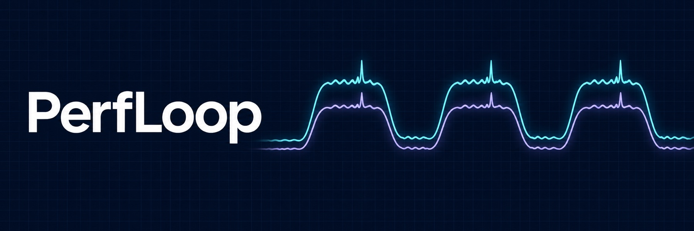

# PerfLoop



**Benchmark real macOS interactions. Verify that a change made them faster.**

PerfLoop is an open-source benchmark runner for SwiftUI and AppKit apps. Run the same interaction on two builds, see where the main thread spends its time, and use correctness checks to decide whether a faster build should become your new baseline. Drive it from the CLI or give a coding agent the same workflow over MCP.

[Quickstart](#quickstart) · [Benchmark results](#benchmark-results) · [Bring your own app](#bring-your-own-app) · [Connect an agent](#connect-an-agent) · [Reference](#reference)

## How it works

1. **Measure a real interaction.** A bench opens your app's actual views with fixture data, drives a scenario such as selecting a row or scrolling a list, and records main-thread CPU, instructions, frame hitches, and long stretches of main-thread work. Optional probes attribute SwiftUI body evaluations to state changes.
2. **Compare against the champion.** PerfLoop interleaves the candidate and current baseline on the same runner. A three-pair screen filters candidates. A promising change advances to a full comparison, which starts with five runs per build and uses noise bands and a Mann–Whitney test.
3. **Check correctness before promotion.** Guards from the champion's manifest check behavior and rendered output. Each experiment leaves an `explain.txt` with the evidence, verdict, and next command. An append-only ledger keeps the history.

## Benchmark results

In the bundled SlowList example, every visible row sorted a 1,000-item list after a selection. A candidate sorted once and let SwiftUI re-evaluate only the two rows whose values changed.

| Selection on a Mac mini | Champion | Candidate |
| --- | ---: | ---: |
| Main-thread CPU per selection | 64.6–65.5 ms | 6.2–6.9 ms |
| SwiftUI row bodies per selection | 15 | 2 |
| Hitch time | 296 ms/s | 0 ms/s |

PerfLoop measured a **90.4% reduction in main-thread CPU** in the full comparison and promoted the fix. A separate candidate that drew blank rows failed the row count guard despite screening 94% faster. [SlowList walkthrough and raw figures](Examples/SlowList/README.md)

## Quickstart

Requires **macOS 14+** and **Swift 5.9+** (Xcode 15+). The in-process stack sampler requires Apple silicon. Optional Instruments profiles use Xcode's `xctrace`.

Build the CLI and preview the bundled walkthrough without opening a bench window.

```sh
git clone https://github.com/MarvinAmador7/perfloop.git
cd perfloop
swift build -c release --product perfloop
export PATH="$PWD/.build/release:$PATH"

cd Examples/SlowList
./walkthrough.sh --dry-run
```

To measure one interaction, run the following while the Mac is free. The last command opens a window for a few seconds.

```sh
swift build -c release --product SlowListBench
perfloop doctor --bench .build/release/SlowListBench
.build/release/SlowListBench run select --reps 1
```

From a clean checkout, run `./walkthrough.sh` to see the full loop screen a runtime knob, reject the blank-row candidate, and confirm and promote the code fix. Allow several minutes for builds and windowed measurements. Use `./walkthrough.sh --runner ssh://user@spare-mac` to open the windows on a spare Mac. [Example bench source](Examples/SlowList/Sources/SlowListBench/main.swift)

## Bring your own app

Scaffold a bench inside your app's Swift package.

```sh
cd /path/to/your/package
perfloop init --app MyApp
```

Add the printed dependency and target declarations to `Package.swift`. In the generated `Sources/MyAppBench/main.swift`, replace the placeholder view with your app's views, add representative fixtures and user actions, and define the checks those actions must pass. Use `--package` with `init` to generate a standalone bench package.

Build and register the baseline from a clean, merged commit.

```sh
swift build -c release --product MyAppBench
perfloop doctor --bench .build/release/MyAppBench
export PERFLOOP_APP=myapp
perfloop store add .build/release/MyAppBench
perfloop champion set BUILD_HASH --merged
```

Replace `BUILD_HASH` with the hash from `store add`. After committing one candidate change, run the screen on a free Mac.

```sh
perfloop exp new "Cache row ranks to remove repeated sorting during selection" \
  --build-cmd "swift build -c release --product MyAppBench" \
  --bench .build/release/MyAppBench
```

Use the returned experiment ID in `perfloop explain exp/ID`. If the verdict is `promising`, run `perfloop exp full ID`. If the screen says `inconclusive` (three pairs couldn't tell: mixed signs, or noise wider than the gain), add pairs with `perfloop exp screen ID --more 3` or run the full; `rejected` is kept for slower in every pair, a failed guard, or a gain that can't reach 5 %. If the full comparison says `won`, run `perfloop exp promote ID` to update the champion. [Bench contract and result schemas](ADAPTER.md)

### Verify that a feature costs nothing

A feature branch asks a different question: does the change cost anything? Add `--expect same`.

```sh
perfloop exp new "Sidebar toggle" --build-cmd "swift build -c release --product MyAppBench" \
  --bench .build/release/MyAppBench --expect same
```

It runs the same interleaved pairs, guards and trust rules, and answers `noRegression`, `regressed` (by how much, on which metric, and where to look) or `inconclusive` (add pairs with `exp screen ID --more 3`, then `exp full ID`, up to 10 + 10). The test is non-inferiority per metric (the objective, and each frame guard both sides report): the paired differences' 90 % interval (Student's t) against the metric's margin, the smallest change worth calling (5 % of CPU per step, 15 % or 3 ms of latency, 25 % of a frame metric), never the run's noise band, so a noisy Mac says "can't tell" rather than "costs nothing". A faster feature costs nothing too. These experiments are never promoted, get no "drop it", and count toward none of the stopping rules. A snapshot that differs from the champion's is listed as a look for the PR, not a verdict.

## Connect an agent

Give your coding agent the generated `PROGRAM.md` and PerfLoop's [agent instructions](AGENTS.md). The agent can inspect the champion, get evidence-backed leads with `perfloop suggest`, and test one hypothesis at a time. The bench, fixtures, and guards stay under the app owner's control.

Use the CLI directly or register the MCP server over stdio. Replace `/path/to/perfloop` with the absolute path to the built executable.

**Codex** (`~/.codex/config.toml`)

```toml
[mcp_servers.perfloop]
command = "/path/to/perfloop"
args = ["mcp", "--app", "myapp"]
```

**Claude Code**

```sh
claude mcp add perfloop -- /path/to/perfloop mcp --app myapp
```

Long-running stages return jobs that the agent can wait on through MCP. The server stops outstanding jobs when the session ends. [Agent workflow and tooling](docs/BEYOND.md)

## Where benchmarks run

| Runner | Use it for |
| --- | --- |
| Local Mac | Interactive work on a free Mac or an idle-gated queue |
| Spare Mac over SSH | Screens and full comparisons on a dedicated machine with an unlocked console session |
| Tart macOS VM | Screening candidates in a guest on the host Mac |

Run `perfloop runner check ssh://user@spare-mac` before using a remote runner. Local window runs wait for the screen to unlock and take turns through a shared window lock. Runs that start on a busy machine or fail to present usable frames are untrusted and cannot decide a verdict.

## Reference

| Task | Command |
| --- | --- |
| Diagnose setup and see the scenarios | `perfloop doctor --bench PATH` · `perfloop describe --bench PATH` |
| Inspect a decision | `perfloop exp status` · `perfloop explain exp/ID` · `perfloop ledger` |
| Check a feature costs nothing | `perfloop exp new "…" --bench PATH --expect same` |
| Add pairs to a screen that couldn't tell | `perfloop exp screen ID --more 3` |
| Find the next bottleneck | `perfloop suggest champion` · `perfloop causes RESULT.json` |
| Profile a build or compare profiles | `perfloop profile champion` · `perfloop diff champion exp/ID` |
| Measure one build, or a new scenario the champion doesn't have (no verdict) | `perfloop run BUILD --scenario S --reference S2` · `perfloop baseline S --bench PATH` |
| Measure how cost grows with fixture size | `perfloop sweep select --set rows=100..5000/500` |
| Queue an experiment | `perfloop queue add ID` · `perfloop queue run --runner local --idle 120` |

`run` and `baseline` go through the same runner as an experiment's stages and print only trusted reps' numbers; a run whose reps were all untrusted says `UNTRUSTED` and quotes nothing (exit 5). A scenario can name its own fixture in the manifest (`scenarios[].fixture`), which every verb uses when `--fixture` is absent; an unlisted `--fixture` is refused with the list ([ADAPTER.md](ADAPTER.md) §2, §3a).

Run `perfloop help` for all commands and flags, and `perfloop COMMAND --help` for one command's usage. An argument a command doesn't take (a typo, `--flag=value`, `--store DIR` passed as one argument, a stray word) is refused with its usage (exit 1) before anything runs. Builds, experiments, `run` measurements, baselines, and the ledger live in `${PERFLOOP_HOME:-~/.perfloop}/<app>/`. Keep raw `.trace` bundles private because they can contain the recorded process's environment.

- [Adapter contract and schemas](ADAPTER.md)
- [PerfLoopHost integration example](Examples/SlowList/Sources/SlowListBench/main.swift)
- [Design and architecture](docs/design/README.md)
- [Agent operating rules](AGENTS.md)
- [Agentic Verification](docs/VERIFICATION.md): proving a UI change works, looks right, and costs nothing (design and roadmap)

## License

[MIT](LICENSE)
